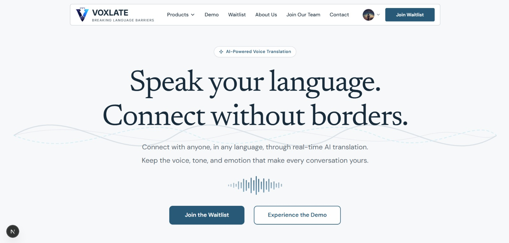
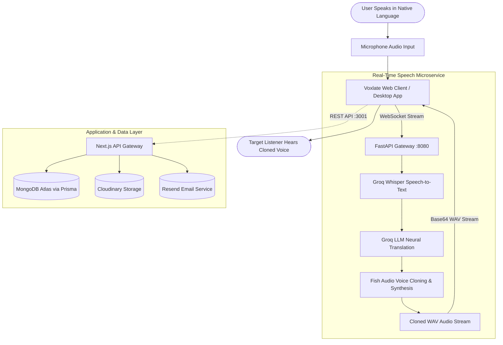

# 🎧⭐ Voxlate — Breaking Language Barriers



Voxlate is an AI-powered real-time voice translation platform designed to eliminate language barriers while preserving the speaker's original voice, tone, and emotion in both online meetings and real-world conversations.

# 🌟 Overview

Built with a high-performance modern full-stack architecture, **Voxlate** brings together real-time streaming speech processing, neural translation, and zero-shot voice cloning.

Whether collaborating remotely over Zoom, Google Meet, and Microsoft Teams, or traveling across the globe, Voxlate enables users to speak naturally in their native language and be heard in any language—speaking with their own voice identity.

The platform provides a comprehensive ecosystem consisting of **Voxlate Digital** (virtual audio meeting software), **Voxlate Physical** (wearable real-time translation hardware concepts), an **Interactive Voice Demo Sandbox**, a **Community Waitlist Directory**, an **Admin Intelligence Dashboard**, and a **Career Application Portal**.

# 📉 Problem Statement

Global communication is constantly hindered by linguistic differences:

- **Robotic & Impersonal Translation:** Traditional text-to-speech (TTS) engines output robotic, synthetic voices that strip away human tone, pitch, emotional nuance, and individuality.
- **Disruptive Meeting Subtitles:** Reading subtitles during high-stakes presentations or business calls divides attention and destroys natural eye contact.
- **Intrusive Meeting Bots:** Most existing meeting translation products require inviting unauthorized third-party bots into conference rooms, creating security, privacy, and compliance concerns.
- **Fragmented Language Tools:** Users must juggle disparate translation apps, transcription utilities, and dictionary lookups instead of engaging in fluid conversations.

Most conventional translation systems translate *words*, but fail to translate the *speaker*.

# ✨ The Solution

**Voxlate** delivers seamless, bidirectional, speech-to-speech translation with instantaneous vocal replication:

- **Natural Speech In, Natural Speech Out:** Speak naturally in your native tongue; the listener hears the translation spoken seamlessly in your cloned voice.
- **Zero Meeting Bots or Extra Links:** Voxlate Digital operates locally through virtual audio input/output devices (Microphone & Speaker) natively selectable in Zoom, Meet, Teams, Webex, and GoTo Meeting.
- **Emotional & Acoustic Fidelity:** Advanced voice cloning models preserve the speaker's unique acoustic timbre, pitch variations, and conversational pacing.
- **Dual Form Factor:** Tailored for both screen-to-screen enterprise collaboration (**Digital Version**) and portable, face-to-face interactions (**Physical Wearable**).
- **Secure by Design:** Built without requiring bot presence in your meetings; speech stream tokens are ephemeral, authenticated, and rate-limited.

# 🛠 Key Features

### 💻 Voxlate Digital (Meeting Software)
- Virtual microphone and speaker driver integration
- Compatibility with Zoom, Google Meet, Microsoft Teams, Cisco Webex, and GoTo Meeting
- Background system tray execution with pause, mute, and live status
- Planned Hindi ↔ English pilot expanding to 100+ global languages

### 🎧 Voxlate Physical (Wearable Hardware)
- Person-to-Person (P2P) mode for bilateral cross-lingual conversations
- Person-to-Environment (P2E) mode for seminars, lectures, guided tours, and local markets
- Compact, all-day wearable form factor with charging case

### 🎙️ Interactive Demo Sandbox
- Web-based live microphone audio recording and streaming preview
- Instantaneous speech recognition, neural translation, and voice synthesis playback
- Gated VIP early access workflow for registered waitlist members

### 📋 Waitlist & Community Directory
- Multi-tier waitlist for individuals, freelancers, and enterprise teams
- Public waitlist directory powered by MongoDB
- Instant confirmation and automated email delivery

### 📊 Admin Intelligence Dashboard
- Real-time waitlist analytics and user onboarding metrics
- Applicant tracking system (ATS) for open engineering and design roles
- CSV export capability for waitlist and applicant data
- Database cleanup utilities and role-based access control (RBAC)

### 💼 Careers Portal
- Interactive job application workflow for remote, on-site, and hybrid roles
- Cloudinary-backed PDF resume uploads with automatic file validation
- Automated applicant tracking and candidate review lifecycle

### 🔐 Authentication & Security
- Secure session authentication powered by JWT and HTTP-only cookies
- Google OAuth 2.0 integration
- Argon2/bcrypt password hashing and credential validation
- Route-level security middleware and anti-tampering guards

# ⚙️ How It Works



1. **Audio Capture:** The speaker delivers voice input through Voxlate's virtual microphone or web recorder.
2. **Streaming Ingestion:** Audio packets are streamed via secure WebSockets to the Python FastAPI speech pipeline.
3. **Ultra-Fast Transcription:** Groq Whisper STT models transcribe speech into contextual text.
4. **Contextual Translation:** Groq LLMs translate the text while preserving idiomatic nuance and conversational context.
5. **Zero-Shot Voice Cloning:** Fish Audio models synthesize translated text using acoustic embeddings extracted from the speaker's voice.
6. **Playback:** The cloned audio is rendered in real time to the listener's virtual speaker or headset.

# 🤖 AI Features

| Capability | Engine / Model | Purpose |
| :--- | :--- | :--- |
| **Speech-to-Text (STT)** | Groq Whisper Large v3 | Near-zero latency multilingual speech recognition |
| **Neural Machine Translation** | Groq LLaMA 3.3 70B / 8B | Contextual translation preserving tone and phrasing |
| **Voice Cloning & TTS** | Fish Audio S2.1 Pro | Zero-shot emotional voice synthesis and timbre replication |

# 🏗 System Architecture

The project is structured into three specialized tiers:

1. **Frontend Client (`voxlate-waitlist`):**
   - Built on **Next.js 16 (App Router)** and **React 19** with **Turbopack**.
   - Styled with modern **Tailwind CSS v4** and fluid **Framer Motion** animations.
   - Handles public landing pages, interactive demo experiences, waitlist directory, and authenticated admin workflows.

2. **Backend API (`voxlate-backend`):**
   - Next.js API server running on port `3001`.
   - **Prisma ORM 6** backed by **MongoDB Atlas**.
   - Handles authentication, admin statistics, job applications, review management, and Cloudinary uploads.

3. **Speech Translation Service (`speech-service`):**
   - **FastAPI WebSocket service** running on port `8080`.
   - Manages asynchronous bidirectional audio streams, chunked base64 WAV encoding, and external AI model orchestration.

# 🧰 Tech Stack

| Category | Technologies |
| :--- | :--- |
| **Frontend** | Next.js 16 (Turbopack), React 19, TypeScript |
| **Styling & UI** | Tailwind CSS v4, Framer Motion, Lucide React |
| **Backend API** | Next.js API Routes, Node.js (>=22.0.0) |
| **Database** | MongoDB Atlas, Prisma ORM 6, Native MongoDB Driver |
| **Speech Microservice** | Python 3.10+, FastAPI, Uvicorn, WebSockets |
| **AI & Voice Models** | Groq Whisper API, Groq LLM API, Fish Audio TTS |
| **Cloud Storage** | Cloudinary (Resumes, profile photos, assets) |
| **Email Service** | Resend API |
| **Authentication** | JWT (`jose`), Google Auth Library, `bcryptjs` |
| **Validation** | Zod, React Hook Form |
| **Testing** | Node.js Native Test Runner (`node --test`), `tsx` |


# 📂 Project Structure

```text
Voxlate-Waitlist-Website/
├── app/                                # Frontend Next.js App Router (Port 3002)
│   ├── about/                          # About Voxlate & Founder story
│   ├── admin/                          # Admin Dashboard & Login
│   ├── api/                            # Frontend API & Reverse Proxy Routes
│   │   ├── [...path]/                  # Reverse proxy forwarder to Backend API
│   │   └── waitlist/                   # Direct MongoDB waitlist query endpoint
│   ├── careers/                        # Careers page & job application form
│   ├── demo/                           # Interactive real-time voice demo sandbox
│   ├── digital-version/                # Voxlate Digital meeting apps overview
│   ├── login/                          # User login page
│   ├── physical-version/               # Voxlate Physical wearable overview
│   ├── privacy/                        # Privacy policy documentation
│   ├── signup/                         # User registration page
│   ├── terms/                          # Terms of service documentation
│   ├── waitlist/                       # Public waitlist directory
│   ├── globals.css                     # Global CSS & Tailwind configuration
│   ├── layout.tsx                      # Root HTML layout with providers
│   └── page.tsx                        # Main landing page
│
├── backend/                            # Backend API Service (Port 3001)
│   ├── app/                            # Backend App Router & API Endpoints
│   │   └── api/
│   │       ├── admin/                  # Admin stats, applications & waitlist export
│   │       ├── auth/                   # Login, signup, me, Google OAuth, logout
│   │       ├── careers/                # Job application submissions
│   │       ├── demo/                   # Demo token issuance & speech ticketing
│   │       ├── reviews/                # User testimonials & review submission
│   │       ├── upload/                 # Cloudinary image & resume upload handler
│   │       └── waitlist/               # Waitlist entry mutations
│   ├── lib/                            # Backend services, auth helpers & Prisma client
│   ├── prisma/                         # Prisma MongoDB schema & seed scripts
│   │   ├── schema.prisma               # Models: User, WaitlistEntry, JobApplication, etc.
│   │   └── seed.ts                     # Database seeder
│   └── tests/                          # Backend integration tests
│
├── speech-service/                     # Real-Time Python Speech Microservice (Port 8080)
│   ├── connector_stream.py             # FastAPI WebSocket audio streaming gateway
│   ├── transcribe_stt.py               # Groq Whisper speech-to-text integration
│   ├── translate.py                    # Groq LLM neural translation engine
│   ├── voice_clone_tts.py              # Fish Audio zero-shot voice cloning client
│   ├── requirements.txt                # Python dependencies
│   └── tests/                          # Speech pipeline test cases
│
├── components/                         # Reusable UI & Page Section Components
│   ├── admin/                          # Admin dashboard components
│   ├── auth/                           # Auth providers and gated hooks
│   ├── layout/                         # Navbar and Footer components
│   ├── sections/                       # Landing page sections (Hero, FAQ, etc.)
│   │   └── digital/                    # Digital version cards, platforms & banners
│   ├── ui/                             # UI primitives (Buttons, Inputs, Logos)
│   └── waitlist/                       # Waitlist modal & button controls
│
├── lib/                                # Frontend core utilities & API clients
│   ├── apiClient.ts                    # Centralized client-side fetch wrapper
│   ├── authApi.ts                      # Client authentication helpers
│   ├── demoTransport.ts                # WebSocket client for demo audio streaming
│   ├── server/                         # Server-side proxy & direct MongoDB connection
│   └── validation.ts                   # Zod schemas for forms
│
├── public/                             # Static assets
│   ├── images/                         # Product mockups, team photos & platforms
│   └── audio/                          # Pre-recorded demo audio clips
│
├── tests/                              # Frontend & reverse proxy integration tests
│   ├── api-integration.test.mjs        # API proxy, cookies & security tests
│   └── careers-client.test.mjs         # Resume upload and job submission tests
│
├── .env                                # Root environment configuration
├── next.config.ts                      # Next.js frontend configuration
├── package.json                        # Root dependencies and unified scripts
└── README.md                           # Project documentation
```


# 🚀 Installation & Setup

### Prerequisites
- **Node.js**: `>= 22.0.0`
- **npm**: `>= 10.0.0`
- **Python**: `>= 3.10` (for Speech Translation Service)
- **MongoDB Atlas** cluster or local MongoDB instance


### 1. Clone the Repository
```bash
git clone https://github.com/BikramMondal5/Voxlate-Waitlist-Website.git
cd Voxlate-Waitlist-Website
```

### 2. Install Dependencies

Install root frontend dependencies:
```bash
npm install
```

Install backend API dependencies:
```bash
npm --prefix backend install
```

Install speech service dependencies:
```bash
cd speech-service
python -m venv .venv
# On Windows:
.venv\Scripts\activate
# On Linux / macOS:
source .venv/bin/activate
pip install -r requirements.txt
cd ..
```


### 3. Configure Environment Variables

#### Root (`.env`):
```env
DATABASE_URL="mongodb+srv://<user>:<password>@<cluster>.mongodb.net/authDB"
MONGODB_URI="mongodb+srv://<user>:<password>@<cluster>.mongodb.net/authDB"
```

#### Backend (`backend/.env`):
```env
DATABASE_URL="mongodb+srv://<user>:<password>@<cluster>.mongodb.net/authDB"
JWT_SECRET="generate-a-strong-secret-key"
ADMIN_NAME="Voxlate Admin"
ADMIN_EMAIL="admin@voxlate.com"
ADMIN_PASSWORD="secure-admin-password"
PORT=3001
FRONTEND_URL="http://localhost:3002"

GOOGLE_CLIENT_ID="your-google-client-id"

CLOUDINARY_CLOUD_NAME="your-cloudinary-name"
CLOUDINARY_API_KEY="your-cloudinary-key"
CLOUDINARY_API_SECRET="your-cloudinary-secret"

RESEND_API_KEY="your-resend-api-key"
RESEND_FROM_EMAIL="Voxlate <no-reply@yourdomain.com>"
```

#### Speech Service (`speech-service/.env`):
```env
DATABASE_URL="mongodb://localhost:27017"
JWT_SECRET="must-match-backend-jwt-secret"
FRONTEND_URL="http://localhost:3002"
GROQ_API_KEY="your-groq-api-key"
FISH_API_KEY="your-fish-audio-key"
FISH_TTS_MODEL="s2.1-pro"
```

### 4. Database Setup & Seeding

Synchronize Prisma schemas and seed the initial administrator account:
```bash
npm run db:push
npm run db:seed
```

### 5. Running the Application

You can run the full-stack development servers concurrently:

```bash
# Runs both Backend (Port 3001) and Frontend (Port 3002)
npm run dev:all
```

To run individual services:
```bash
# Frontend only (Port 3002)
npm run dev

# Backend only (Port 3001)
npm run dev:backend

# Speech WebSocket Service (Port 8080)
cd speech-service
uvicorn connector_stream:app --host 0.0.0.0 --port 8080 --reload
```

Open [http://localhost:3002](http://localhost:3002) in your browser to view the application.


# 🔐 Environment Variables

| Variable | Scope | Description |
| :--- | :--- | :--- |
| `DATABASE_URL` | Root & Backend | MongoDB connection string for Prisma ORM |
| `MONGODB_URI` | Root | Direct connection string for high-speed waitlist queries |
| `JWT_SECRET` | Backend & Speech | Shared secret for signing auth tokens & demo tickets |
| `ADMIN_EMAIL` | Backend | Default administrator email for seeding |
| `ADMIN_PASSWORD` | Backend | Default administrator password for dashboard login |
| `FRONTEND_URL` | Backend | Permitted CORS origin for frontend client (`http://localhost:3002`) |
| `GOOGLE_CLIENT_ID` | Backend | Google OAuth 2.0 Client ID for Google Sign-In |
| `CLOUDINARY_CLOUD_NAME` | Backend | Cloudinary cloud identifier for resume/image hosting |
| `CLOUDINARY_API_KEY` | Backend | Cloudinary API Key |
| `CLOUDINARY_API_SECRET` | Backend | Cloudinary API Secret |
| `RESEND_API_KEY` | Backend | Resend API key for automated confirmation emails |
| `RESEND_FROM_EMAIL` | Backend | Sender email address for outgoing system emails |
| `GROQ_API_KEY` | Speech Service | Groq API key for Whisper STT and translation |
| `FISH_API_KEY` | Speech Service | Fish Audio API key for voice cloning & speech synthesis |
| `FISH_TTS_MODEL` | Speech Service | Voice synthesis model identifier (e.g. `s2.1-pro`) |

# 🧪 Testing

Run comprehensive integration tests across frontend, backend, and API contracts:

```bash
# Run frontend integration tests
npm test

# Run backend integration tests
npm run test:backend

# Run all test suites across the repository
npm run test:all
```
